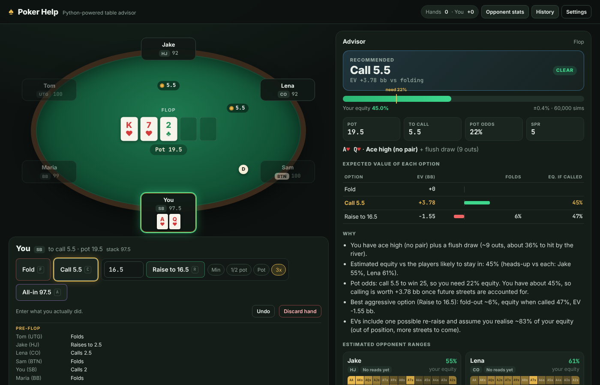

# Poker Help ♠

A no-limit Texas hold'em advisor written in **Python**. You enter what happens at your table: the number of players, your cards, everyone's decisions, then the flop, turn and river. At every one of your decisions the bot tells you, with the maths, what you should do. Over a session it tracks how each opponent plays and uses that to sharpen its advice.

**Website:** https://luca-pfi.github.io/Poker-Help/ (served by GitHub Pages. The Python engine runs in your browser through [Pyodide](https://pyodide.org), so no server is needed.)



## Using it

1. **Start a session**: choose the number of players (2 to 10), your seat, the blinds and the starting stack. Player names are optional but help you keep track of who's who.
2. **Deal a hand**: pick your two hole cards by clicking them or typing them (e.g. `AhKd`). The dealer button moves automatically.
3. **Enter the action**: the app knows whose turn it is. Click each player's decision (fold / check / call / bet or raise with an amount / all-in). Then enter the flop, turn and river when asked. Keyboard shortcuts: `F` fold, `K` check, `C` call, `R` raise, `A` all-in, `U` undo.
4. **When it's your turn** the advisor shows:
   - the **recommended play** and how clear-cut it is
   - your **equity** against the players likely to stay in, next to the **pot odds** you need
   - the **expected value (EV)** of every option (fold, check/call, several bet or raise sizes, all-in) with fold-out % and equity when called
   - a plain-English **"why"**
   - a 13×13 **range grid** for each opponent, showing which hands the bot thinks they hold
5. **At showdown**, enter any cards that were shown and pick the winner(s). Side pots are handled. Every saved hand updates the opponents' statistics.

The session (stats, stacks, history) is saved in your browser automatically. You can export or import it as JSON from *Settings*.

## How the maths works

| Step | What happens |
|---|---|
| **Hand evaluation** | A fast pure-Python 7-card evaluator (`evaluator.py`) using incremental rank, suit and flush keys plus lookup tables. Verified against a brute-force evaluator in the tests. |
| **Starting-hand strength** | The 169 starting hands are ranked by simulated equity against 1 and 3 random hands, plus a small playability bonus (`tools/gen_preflop_rankings.py`). "Top 15% of hands" ranges are built from this order. |
| **Opponent ranges** | Each opponent's range is a weighted set of all 1,326 hole-card combos. It is narrowed by replaying their actions in this hand: an open-raise keeps their raising range for that position, a 3-bet their 3-bet range, a call removes their weakest hands, a bet or raise keeps the stronger part plus some bluffs, and so on. |
| **Opponent tracking** | Per player: VPIP, PFR, 3-bet, fold to 3-bet, c-bet, fold to c-bet, fold to bet, aggression (AF/AFq), WTSD and W$SD, plus every hand they showed. Each stat is blended with a population prior (`(count + prior × k) / (opportunities + k)`), so a few hands don't swing the advice but real tendencies take over as data comes in. Players are classified (Nit, TAG, LAG, Calling station, Maniac, ...) with exploit notes. |
| **Monte Carlo** | Thousands of run-outs: each opponent's hand is drawn from their weighted range and the board is completed. For every option, each opponent continues only if their hand is strong enough given how often they fold, and the strongest part of their continuing hands re-raises. One simulation therefore gives the fold-out probability, the equity when called and the equity against a re-raise. |
| **Expected value** | `EV = P(all fold) × pot + P(called) × (equity × realisation × final pot − cost) + P(re-raised) × max(call it, fold)`. Fold is the 0 baseline. Realisation discounts equity you can't fully use (out of position, more streets to come). It is 100% on the river and when all-in. |
| **Recommendation** | The option with the highest EV wins. Near-ties go to the simpler, lower-variance play. Unopened pre-flop pots use position-based opening ranges, widened or tightened by how often the players behind you fold. |

All of this lives in the `poker_bot` package. The web page is only a view: every click calls `poker_bot.api.call(...)` inside a Web Worker.

## Running locally

No dependencies are needed for the engine (Python 3.10+).

```bash
python -m poker_bot          # terminal version of the advisor (resumes your last session)
python -m poker_bot --new    # start a fresh session
```

To serve the website locally:

```bash
python -m http.server 8000   # then open http://localhost:8000
```

Tests (`pip install pytest`):

```bash
python -m pytest -q
```

To regenerate the starting-hand ranking:

```bash
python tools/gen_preflop_rankings.py 40000
```

## Publishing the website

The site is plain static files at the repository root (`index.html`, `assets/`, `poker_bot/`). To publish it: **Settings → Pages → Build and deployment → Deploy from a branch → `main` / `(root)`**. The `.nojekyll` file is required: without it GitHub's Jekyll step would drop `poker_bot/__init__.py`.

## Project layout

```
index.html, assets/       web front end (app.js = UI, worker.js = Pyodide bridge, style.css)
poker_bot/
  cards.py                card parsing, 169 hand classes
  evaluator.py            7-card hand evaluator
  preflop_data.py         generated starting-hand ranking
  ranges.py               range construction, board strength, draws, range grids
  equity.py               Monte Carlo engine with fold / continue / re-raise thresholds
  game.py                 hand state machine: blinds, betting rounds, side pots, undo
  tracker.py              opponent statistics, priors, player profiles
  advisor.py              range estimation from actions, options, EV, explanations
  session.py              table, stacks, button, history, JSON save/load
  api.py                  JSON API used by the web page
  cli.py                  terminal interface
tests/                    evaluator, game rules, side pots, stats, advisor sanity checks
tools/                    data generation scripts
```

## Limitations

The advisor is a model, not a solver. It simplifies multi-street play (equity realisation factors, at most one re-raise per decision), and its opponent models start from typical low-stakes tendencies until it has seen enough hands. Treat close decisions as close. Check that using an assistant is allowed wherever you play: most online poker sites ban real-time assistance tools.
