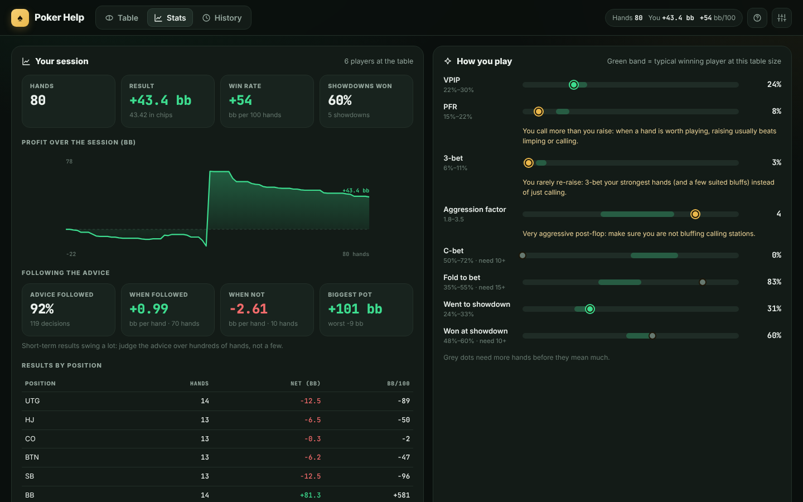

# Poker Help ♠

A no-limit Texas hold'em advisor written in **Python**. You enter what happens at your table: the number of players, your cards, everyone's decisions, then the flop, turn and river. At every one of your decisions the bot tells you, with the maths, what you should do. Over the session it tracks how every player plays (including you), and that sharpens its advice.

**Website:** https://luca-pfi.github.io/Poker-Help/ (GitHub Pages; the Python engine runs in your browser through [Pyodide](https://pyodide.org), so no server is needed).


## Features

- **Fast hand entry**: tap your cards (or type `AhKd`), then each player's action. **Folds to you** / **Checks to you** skip straight to your turn, **Undo** steps back, and keyboard shortcuts (`F` `K` `C` `R` `A` `U`) work too.
- **Advice at every decision**: the recommended play with a one-sentence reason ("Bet for value: worse hands call and you have 72% when called"), plus **Follow advice** to enter it in one tap.
  - **Simple** view: the action, your equity vs. the equity you need, and your equity against each opponent.
  - **Detailed** view: the expected value (EV) of every option, how often they fold, your equity when called, the full reasoning, and a 13×13 grid of each opponent's likely hands.
- **Stats HUD on every seat** for every player, **including you**: VPIP/PFR, aggression and hands tracked, plus your result against that player.
- **Stats page**:
  - your profit curve, win rate (bb/100), results by position and showdown win rate
  - **whether following the advice paid off** (bb per hand when you followed it vs. when you didn't)
  - **how you play**: your VPIP, PFR, 3-bet, aggression, c-bet, fold-to-bet, WTSD and W$SD compared with a winning player's range at your table size, with coaching tips
  - **you vs. the table**: every opponent's stats next to yours, plus head-to-head results (hands together, your result, showdowns won and lost)
  - a card per opponent with their player type, how to exploit them, and the hands they've shown
- **History** of every hand with the full action log.
- **Opponent profiling**: Nit, Rock, TAG, LAG, Maniac, Calling station or Regular, judged against the table size (60% VPIP is loose at 6-max but normal heads-up).
- Sessions save automatically in your browser, and can be exported or imported as JSON.



## How the maths works

| Step | What happens |
|---|---|
| **Hand evaluation** | A fast pure-Python 7-card evaluator (incremental rank/suit/flush keys + lookup tables), verified against brute force in the tests. |
| **Starting-hand strength** | The 169 starting hands are ranked by simulated equity against 1 and 3 random hands, plus a playability bonus (`tools/gen_preflop_rankings.py`). |
| **Opponent ranges** | Each opponent's range is a weighted set of the 1,326 hole-card combos. It is narrowed by replaying their actions: opens use position- and table-size-aware widths, 3-bets include suited bluffs and widen against late-position opens, calls remove the weakest hands, c-bets keep plenty of air for frequent c-bettors, and a check only signals weakness when the player had the initiative. |
| **Opponent tracking** | VPIP, PFR, 3-bet, fold to 3-bet, c-bet, fold to c-bet, fold to bet, aggression, WTSD, W$SD and shown hands. Estimates are blended with population priors scaled to the table size, so a few hands don't swing the advice. |
| **Monte Carlo** | Thousands of run-outs per decision. For every option, each opponent continues only if their hand is strong enough given their fold tendency and the bet size, and the strongest part of their continuing hands re-raises. One simulation yields the fold-out probability, the equity when called and the equity against a re-raise. |
| **Expected value** | `EV = P(all fold) × pot + P(called) × (equity × realisation × final pot − cost) + P(re-raised) × max(call, fold)`. Realisation depends on position, streets left and hand strength (weak hands realise less). Pre-flop calls get an implied-odds bonus for pairs and suited hands. |
| **Recommendation** | The highest-EV option wins. Pre-flop bluff re-raises and raises over a bet need a small safety margin. Unopened pots use position-based opening ranges, adjusted for how loose the players behind are and how loose any limpers are. |

## How good is it?

`tools/evaluate.py` measures the bot instead of guessing: it plays 90,000 simulated hands against scripted opponents and checks its frequencies against theory. The latest results and the before/after comparison are in [docs/evaluation.md](docs/evaluation.md).

## Running locally

The engine has no dependencies (Python 3.10+).

```bash
python -m poker_bot          # terminal version of the advisor (resumes your last session)
python -m poker_bot --new    # start a fresh session
```

To serve the website locally:

```bash
python -m http.server 8000   # then open http://localhost:8000
```

Tests (`pip install pytest`):

```bash
python -m pytest -q
```

To re-run the evaluation (about 10 minutes on 4 cores):

```bash
python tools/evaluate.py 6000 > report.json
```

## Publishing the website

The site is plain static files (`index.html`, `assets/`, `poker_bot/`) served by GitHub Pages from the **`gh-pages`** branch. To publish changes, push `main` to it:

```bash
git push origin main:gh-pages
```

The `.nojekyll` file is required: without it, GitHub's Jekyll step would drop `poker_bot/__init__.py`.

## Project layout

```
index.html, assets/       web front end (app.js = UI, worker.js = Pyodide bridge, style.css)
poker_bot/
  cards.py                card parsing, 169 hand classes
  evaluator.py            7-card hand evaluator
  preflop_data.py         generated starting-hand ranking
  ranges.py               range construction, board strength, draws, table-size widths
  equity.py               Monte Carlo engine with fold / continue / re-raise thresholds
  game.py                 hand state machine: blinds, betting rounds, side pots, undo
  tracker.py              player statistics, priors, profiles, benchmarks
  advisor.py              range estimation, options, EV, explanations, summaries
  session.py              table, stacks, your record, head-to-head, history, save/load
  api.py                  JSON API used by the web page
  cli.py                  terminal interface
tests/                    evaluator, game rules, side pots, stats, advisor sanity checks
tools/                    hand-ranking generator, evaluation harness
docs/                     screenshots, evaluation report
```

## Limitations

The advisor is a model, not a solver. It simplifies multi-street play (equity realisation factors, at most one re-raise per decision), and its opponent models start from typical low-stakes tendencies until it has seen enough hands. Treat close decisions as close. Check that using an assistant is allowed wherever you play: most online poker sites ban real-time assistance tools.
